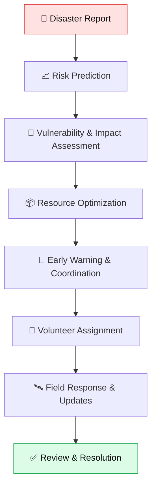
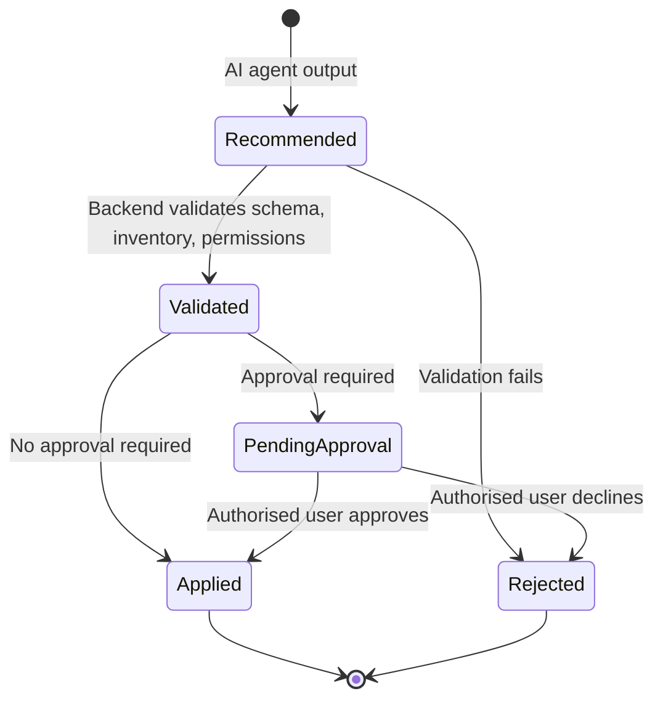
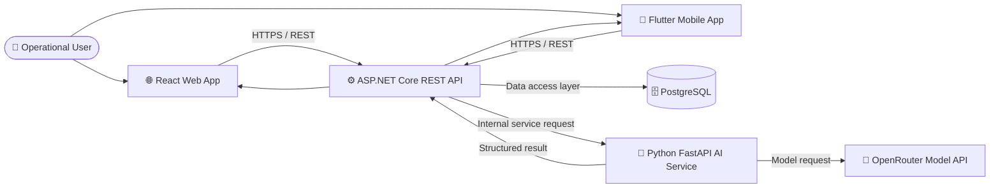
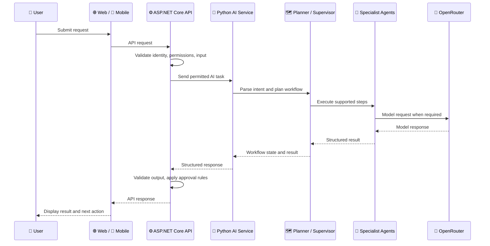
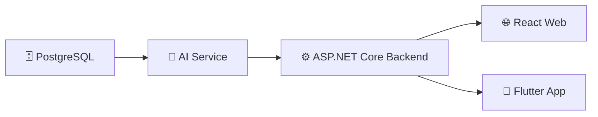
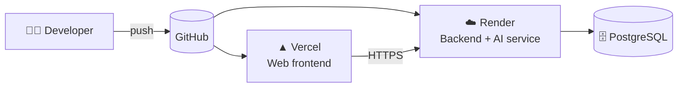

<a id="top"></a>

<div align="center">

# 🌍 ReliefNexus

### AI-Powered Disaster Management & Agentic AI Platform

**`REPORT`** · **`ASSESS`** · **`PLAN`** · **`WARN`** · **`RESPOND`**

<br/>

*Connecting disaster reporting, risk assessment, resource planning, early warning, volunteer coordination and field response in one platform.*

<br/>


<br/>

[**Overview**](#-overview) ·
[**Quick Start**](#-quick-start) ·
[**Features**](#-features) ·
[**Architecture**](#-architecture) ·
[**Agentic AI**](#-agentic-ai) ·
[**Configuration**](#-configuration) ·
[**Testing**](#-testing) ·
[**Deployment**](#-deployment)

</div>

---

> [!IMPORTANT]
> **Accuracy note:** This README is based on the existing project documentation. Confirm paths, commands, environment variables, API routes, feature completeness and deployment status against the current repository before relying on them. Source-code presence alone does not prove runtime correctness or production readiness.

## 📑 Table of Contents

<table>
<tr>
<td valign="top">

**Understand**
- [Overview](#-overview)
- [Features](#-features)
- [User Roles](#-user-roles)
- [Workflow](#-workflow)
- [Technology Stack](#-technology-stack)
- [Architecture](#-architecture)
- [Agentic AI](#-agentic-ai)

</td>
<td valign="top">

**Build & Run**
- [Quick Start](#-quick-start)
- [Repository Structure](#-repository-structure)
- [Configuration](#-configuration)
- [Local Setup](#-local-setup)
- [Database](#-database)
- [API and Communication](#-api-and-communication)

</td>
<td valign="top">

**Trust & Ship**
- [Testing](#-testing)
- [Security & Responsible AI](#-security-and-responsible-ai)
- [Deployment](#-deployment)
- [Troubleshooting](#-troubleshooting)
- [Implementation Status](#-implementation-status-tracker)
- [FAQ](#-faq)
- [Contributing](#-contributing)
- [License](#-license)

</td>
</tr>
</table>

---

## 🔭 Overview

**ReliefNexus** is a disaster-management and emergency-response platform. It provides connected workflows for:

📝 reporting incidents  ·  📊 assessing risk  ·  🧭 identifying vulnerability and impact  ·  📦 planning resources  ·  🚨 coordinating warnings  ·  🙋 assigning volunteers  ·  🛰️ tracking field response

The documented system includes a **React** web client, a **Flutter** mobile client, an **ASP.NET Core** REST API, **PostgreSQL** with Entity Framework Core, and a **Python/FastAPI** AI service integrated with **OpenRouter**. The backend is intended to remain the control boundary for authentication, authorisation, data persistence, validation and consequential state changes.

### 🧱 At a glance

| | Component | Technology | Role in the system |
|:-:|---|---|---|
| 🌐 | **Web app** | React · TypeScript · Vite | Dashboards, forms, workflow views |
| 📱 | **Mobile app** | Flutter · Dart | Field and on-the-go workflows |
| ⚙️ | **Backend API** | ASP.NET Core · .NET 8 | Control boundary: auth, rules, persistence |
| 🗄️ | **Database** | PostgreSQL · EF Core | Durable application data |
| 🧠 | **AI service** | Python · FastAPI | Agent workflows and planning |
| 🚪 | **Model gateway** | OpenRouter | External LLM access |

### 🎯 Goals

| | Goal |
|:-:|---|
| 🔗 | Connect disaster reports, assessments, resources and field operations. |
| 🧮 | Support structured risk and vulnerability analysis. |
| 🧑‍✈️ | Help coordinators evaluate response options and resource requirements. |
| 🔍 | Make AI-assisted planning and execution more traceable. |
| 📱 | Provide web and mobile access to supported workflows. |
| 🧑‍⚖️ | Preserve human oversight over consequential emergency actions. |

### 🧭 Design principles

| Principle | What it means in practice |
|---|---|
| **Backend is the authority** | Permissions, validation and state changes are enforced server-side, never only in the UI. |
| **AI recommends, humans decide** | Model output is advisory until validated and, where required, approved. |
| **Constraints are deterministic** | Inventory, eligibility and permission rules are code, not model opinion. |
| **Failures are visible** | Uncertainty, errors and approval status are surfaced rather than hidden. |
| **Evidence over assumption** | Claims about completeness or accuracy need tests, data or logs behind them. |

<div align="right"><a href="#top">⬆ back to top</a></div>

---

## ⚡ Quick Start

> [!NOTE]
> Condensed from the detailed [Local Setup](#-local-setup). Confirm paths and scripts in your checkout first.

```powershell
# 1. Get the code
git clone https://github.com/ResQAI-Dev/ReliefNexus.git
cd ReliefNexus

# 2. AI service            (terminal 1)
cd ai-service
py -m venv .venv ; .\.venv\Scripts\Activate.ps1
py -m pip install -r requirements.txt
py -m uvicorn app.main:app --reload --port 8000

# 3. Backend API           (terminal 2)  — PostgreSQL must be running & configured
cd backend\ReliefNexus.API
dotnet restore ; dotnet run

# 4. Web app               (terminal 3)
cd frontend
npm install ; npm run dev

# 5. Mobile app            (terminal 4)
cd mobile
flutter pub get ; flutter run
```

| Step | Needs configured first |
|:-:|---|
| 2 | `OPENROUTER_API_KEY`, `OPENROUTER_MODEL` |
| 3 | Database connection string, JWT settings, AI-service URL |
| 4 | `VITE_API_BASE_URL` |
| 5 | An API host reachable from your emulator or device |

<div align="right"><a href="#top">⬆ back to top</a></div>

---

## ✨ Features

> [!NOTE]
> These feature areas come from existing project documentation. Verify the current UI, backend, persistence, permissions and tests before treating any feature as complete. See the [Implementation Status Tracker](#-implementation-status-tracker).

| | Feature | Purpose |
|:-:|---|---|
| 🆘 | **Disaster reports** | Submit and manage incident information. |
| 📈 | **Risk prediction** | Produce structured risk information such as score, category or confidence where supported. |
| 🧬 | **Vulnerability & impact** | Assess potential impacts, vulnerable populations, severity and response needs. |
| 📦 | **Resource optimization** | Recommend resources subject to actual inventory and eligibility rules. |
| 🚨 | **Early warning & coordination** | Prepare warning and coordination recommendations. |
| 🙋 | **Volunteer assignment** | Support volunteer matching and assignment workflows. |
| 🛰️ | **Field operations** | Let field volunteers view assigned work and submit updates where implemented. |
| 🤲 | **Assistance requests** | Support relief requests where implemented. |
| 👥 | **User management** | Manage accounts and role-based access. |
| 🔔 | **Notifications & location sharing** | Support operational communication where configured. |
| 🤖 | **AI execution visibility** | Show workflow state and agent results where implemented. |
| 🌐 | **Web & mobile access** | Provide React and Flutter interfaces. |

---

## 👥 User Roles

| Role | Intended responsibility |
|---|---|
| 🧑‍🤝‍🧑 **Affected User** | Submit reports or assistance requests and access permitted information. |
| 🧑‍💼 **Relief Coordinator** | Review incidents and coordinate response activities within assigned permissions. |
| 🦺 **Field Volunteer** | View assigned work and submit field response updates within assigned permissions. |
| 🛡️ **System Administrator** | Manage system-level functions according to configured permissions. |

> [!WARNING]
> The authoritative permissions must be verified in backend policies, claims, role definitions and client route guards. **Hiding a UI control is not a substitute for server-side authorisation.**

<details>
<summary><b>🔐 Role-permission matrix template (click to expand)</b></summary>

<br/>

Fill this in from the actual backend policies. Do not mark anything ✅ without evidence.

| Capability | Affected User | Relief Coordinator | Field Volunteer | System Administrator |
|---|:-:|:-:|:-:|:-:|
| Submit a disaster report | ❔ | ❔ | ❔ | ❔ |
| View incident details | ❔ | ❔ | ❔ | ❔ |
| Trigger AI assessment | ❔ | ❔ | ❔ | ❔ |
| Approve warnings | ❔ | ❔ | ❔ | ❔ |
| Assign volunteers | ❔ | ❔ | ❔ | ❔ |
| Submit field updates | ❔ | ❔ | ❔ | ❔ |
| Manage users | ❔ | ❔ | ❔ | ❔ |

**Legend:** ✅ verified allowed · ⛔ verified denied · ❔ not yet verified

</details>

---

## 🔄 Workflow



Actual paths may vary according to incident type, data availability, permissions, resource eligibility and approval status.

### 🚦 Approval gate (intended principle)

Consequential actions should pass through validation and, where the workflow requires it, human approval before they take effect.



> Verify which actions in the current code actually require approval.

---

## 🧰 Technology Stack

| Layer | Technology | Responsibility |
|---|---|---|
| 🌐 **Web** | React, TypeScript, Vite | Browser interface |
| 📱 **Mobile** | Flutter, Dart | Mobile interface |
| ⚙️ **Backend** | ASP.NET Core / .NET 8 | API, business rules, authorisation, orchestration |
| 🗄️ **Database** | PostgreSQL | Persistent application data |
| 🔌 **ORM** | Entity Framework Core | Data access and migrations |
| 🧠 **AI service** | Python, FastAPI | AI request handling and agent workflows |
| 🚪 **LLM gateway** | OpenRouter | Model API access |
| 🤖 **Reported model** | `openai/gpt-oss-20b` | *Verify against runtime configuration* |
| 🧪 **Backend tests** | xUnit | *Verify test project and configuration* |
| 🎭 **E2E tests** | Playwright | *Verify configuration and test files* |
| 📲 **Mobile tests** | Flutter test | Flutter test suite |
| ☁️ **Web hosting (reported)** | Vercel | *Verify current deployment settings* |
| ☁️ **Backend / AI / DB hosting (reported)** | Render | *Verify current deployment settings* |

---

## 🏗️ Architecture



> This diagram reflects the documented intended architecture. Verify the actual service URLs, authentication path and deployment networking in source and hosting configuration.

### 🧩 Component responsibilities

| Component | Responsibility |
|---|---|
| **Web frontend** | Pages, dashboards, forms, navigation and API-driven UI state. |
| **Mobile application** | Mobile screens and supported workflows using the configured backend API. |
| **ASP.NET Core backend** | Endpoints, business rules, permissions, validation, persistence and controlled AI integration. |
| **Python AI service** | AI request processing, planning and agent execution where implemented. |
| **PostgreSQL** | Persistent data managed by the configured backend data layer. |
| **OpenRouter** | External model API access for the AI service. |

### 🛡️ Trust boundaries

| Boundary | Rule |
|---|---|
| Client → Backend | Treat all client input as untrusted. Authenticate, authorise and validate. |
| Backend → AI service | Send only permitted data. Restrict the AI service to intended network paths. |
| AI service → Model provider | Minimise sensitive data sent externally. Keep the API key server-side. |
| AI output → Backend | Treat as untrusted text. Parse, validate and map to supported operations only. |

<div align="right"><a href="#top">⬆ back to top</a></div>

---

## 🤖 Agentic AI

Existing documentation describes **five specialist agents**:

| # | Agent | Intended responsibility | Key validation concerns |
|:-:|---|---|---|
| 01 | 📈 **Risk Prediction** | Structured risk score/category and confidence where supported. | Validate inputs and outputs; record provenance and uncertainty. |
| 02 | 🧬 **Vulnerability & Impact** | Vulnerability, impact, severity, affected population and recommendations where supported. | Link to the correct assessment and validate required data. |
| 03 | 📦 **Resource Optimization** | Resource recommendations based on needs and inventory. | Enforce actual inventory, eligibility and quantity constraints. |
| 04 | 🚨 **Early Warning & Coordination** | Warning and coordination recommendations. | Apply appropriate approval before external actions. |
| 05 | 🙋 **Volunteer Assignment** | Volunteer matching and assignment support. | Validate availability, permissions and assignment rules. |

### 🔁 Intended orchestration sequence



> Verify the exact call sequence and which agents use the model before treating this as an implementation trace.

### 🛡️ AI safety principles

- ✅ Validate model responses before using them in application logic.
- ✅ Map plans to supported backend operations; **never** execute arbitrary model-generated instructions.
- ✅ Keep permission enforcement in the backend.
- ✅ Bound retries and replanning.
- ✅ Make failures, uncertainty and approval status visible.
- ✅ Require appropriate human approval for consequential actions.
- ✅ Do not present AI-generated risk information as guaranteed truth or a replacement for authorised emergency decisions.

<div align="right"><a href="#top">⬆ back to top</a></div>

---

## 📂 Repository Structure

> [!NOTE]
> This is the high-level structure recorded in existing project documentation. It is not guaranteed to be an exhaustive current tree. Check the checkout and update paths before relying on them.

```text
ReliefNexus/
├── 🖥️  backend/
│   ├── ReliefNexus.API/
│   │   ├── AI/
│   │   ├── Controllers/
│   │   ├── Data/
│   │   ├── Interfaces/
│   │   ├── Migrations/
│   │   ├── Models/
│   │   ├── Services/
│   │   └── Program.cs
│   └── ReliefNexus.API.Tests/
├── 🌐 frontend/
│   ├── src/
│   │   ├── app/
│   │   ├── components/
│   │   └── features/
│   ├── public/
│   ├── tests/
│   ├── package.json
│   └── vite.config.*
├── 📱 mobile/
│   ├── lib/
│   ├── android/
│   ├── ios/
│   ├── assets/
│   ├── test/
│   ├── pubspec.yaml
│   └── README.md
├── 🧠 ai-service/
│   ├── app/
│   └── requirements.txt
├── ⚙️  .github/
│   └── workflows/
└── README.md
```

<details>
<summary><b>📖 Folder reference (click to expand)</b></summary>

<br/>

| Path | Responsibility |
|---|---|
| `backend/ReliefNexus.API/Controllers/` | Backend HTTP endpoints, subject to current implementation. |
| `backend/ReliefNexus.API/Services/` | Application and business services. |
| `backend/ReliefNexus.API/Models/` | Backend data/domain models. |
| `backend/ReliefNexus.API/Data/` | Database context and persistence configuration. |
| `backend/ReliefNexus.API/Migrations/` | Entity Framework Core migrations. |
| `backend/ReliefNexus.API/AI/` | Backend AI integration/orchestration components if present. |
| `backend/ReliefNexus.API.Tests/` | Backend tests if present. |
| `frontend/src/` | React application source. |
| `frontend/src/features/` | Feature modules if present. |
| `frontend/src/components/` | Shared UI components if present. |
| `frontend/tests/` | Frontend tests if present. |
| `mobile/lib/` | Flutter source code. |
| `mobile/test/` | Flutter tests. |
| `mobile/android/`, `mobile/ios/` | Native platform configuration. |
| `ai-service/app/` | Python AI service code if matching the current layout. |
| `.github/workflows/` | GitHub Actions workflows if configured. |

For a fully exact folder reference, regenerate this tree from the current repository and include all meaningful first-party feature subdirectories.

</details>

---

## ⚙️ Configuration

The names below are reported by existing documentation. Verify them against configuration code and deployment settings.

### 🧾 Environment variable summary

| Variable | Component | Purpose | Secret? |
|---|---|---|:-:|
| `ConnectionStrings__DefaultConnection` | Backend | PostgreSQL connection | 🔒 Yes |
| `Jwt__Key` | Backend | JWT signing key | 🔒 Yes |
| `Jwt__Issuer` | Backend | JWT issuer | No |
| `Jwt__Audience` | Backend | JWT audience | No |
| *(AI-service URL; exact name defined by backend)* | Backend | Address of the AI service | No |
| `OPENROUTER_API_KEY` | AI service | Model provider key | 🔒 Yes |
| `OPENROUTER_MODEL` | AI service | Model identifier (reported: `openai/gpt-oss-20b`) | No |
| `VITE_API_BASE_URL` | Frontend | Backend API base URL | No *(public by design)* |

<details open>
<summary><b>🖥️ Backend</b></summary>

```text
ConnectionStrings__DefaultConnection
Jwt__Key
Jwt__Issuer
Jwt__Audience
```

Also configure the AI-service base URL using the exact setting name defined by the backend.

</details>

<details open>
<summary><b>🧠 AI service</b></summary>

```dotenv
OPENROUTER_API_KEY=your_openrouter_api_key
OPENROUTER_MODEL=openai/gpt-oss-20b
```

Verify whether both variables are required and whether the model identifier matches current runtime configuration.

</details>

<details open>
<summary><b>🌐 Frontend</b></summary>

```dotenv
VITE_API_BASE_URL=https://reliefnexus.onrender.com/api
```

For local development, use the actual local backend URL and API prefix expected by the frontend client.

</details>

> [!CAUTION]
> **Secrets policy**
> - Never commit API keys, database passwords, JWT signing keys or tokens.
> - Do not put server-side secrets in `VITE_*` variables. They are exposed to browser code.
> - Use local environment files excluded from Git, or the hosting provider's secret configuration.
> - Rotate any credential that has been committed. Deleting it from the latest revision is not enough.

---

## 🛠️ Local Setup

Commands below are starting points based on the documented folder layout. Confirm paths, entry points and scripts in the current checkout before using them.

### ✅ Prerequisites

| Tool | Needed for |
|---|---|
| **Git** | Cloning the repository |
| **.NET 8 SDK** | ASP.NET Core backend |
| **Node.js + npm** | React / Vite frontend |
| **Python 3.x** | FastAPI AI service |
| **Flutter SDK** (includes Dart) | Mobile app |
| **PostgreSQL** | Database |
| **Android Studio + Android SDK** | Android emulator, or use a configured physical device |

Use the actual project manifests to resolve version differences.

### 1️⃣ Clone the repository

```powershell
git clone https://github.com/ResQAI-Dev/ReliefNexus.git
cd ReliefNexus
```

### 2️⃣ Prepare PostgreSQL

1. Start PostgreSQL.
2. Create a development database.
3. Configure the backend connection string.
4. Confirm the database user has suitable development permissions.
5. Apply the project's Entity Framework Core migrations using the actual solution/project configuration.

> [!TIP]
> Review migrations before applying them to any production database.

### 3️⃣ Start the AI service

From the actual AI-service directory, if it contains `requirements.txt` and `app/main.py`:

```powershell
py -m venv .venv
.\.venv\Scripts\Activate.ps1
py -m pip install -r requirements.txt
```

Configure the required environment variables, then, if `app.main:app` is the real FastAPI entry point:

```powershell
py -m uvicorn app.main:app --reload --port 8000
```

### 4️⃣ Start the backend

In a separate terminal:

```powershell
cd backend\ReliefNexus.API
dotnet restore
dotnet build
dotnet run
```

Set database, authentication and AI-service configuration first. Use the URL printed by the running application. `/swagger` is available only if Swagger is enabled in that environment.

### 5️⃣ Start the frontend

In a separate terminal:

```powershell
cd frontend
npm install
npm run dev
```

Confirm the scripts in `frontend/package.json` and configure the API base URL.

### 6️⃣ Start the Flutter application

In a separate terminal:

```powershell
cd mobile
flutter pub get
flutter devices
flutter run
```

> [!TIP]
> On the Android emulator, `localhost` is **not** your computer's `localhost`. Configure the API host address appropriate to the emulator. For a physical device, make sure network routing, firewall and HTTP/HTTPS settings permit access.

### 🔢 Typical startup order



The actual order depends on the feature being tested. The AI service is only needed for AI-backed workflows.

<div align="right"><a href="#top">⬆ back to top</a></div>

---

## 🗄️ Database

PostgreSQL with Entity Framework Core is the backend persistence stack. Migrations live in:

```text
backend/ReliefNexus.API/Migrations/
```

An `InitialCreate` migration is mentioned in existing documentation. Confirm the actual migration files and schema before applying changes.

**Recommended practices**

- 🔹 Evolve the schema through reviewed migrations.
- 🔹 Keep database credentials outside source control.
- 🔹 Validate input before persistence.
- 🔹 Use constraints and transactions where required for consistency.
- 🔹 Avoid destructive database resets where data must be retained.
- 🔹 Keep AI recommendations separate from authorised state changes until validation and approval rules are satisfied.

> Create an ER diagram from actual entities and migrations rather than inferring table names from feature names.

---

## 🔌 API and Communication

The web and mobile clients call the ASP.NET Core API. The backend calls the Python AI service, which integrates with OpenRouter.

Reported frontend API base URL:

```text
https://reliefnexus.onrender.com/api
```

> [!TIP]
> Verify the current URL and base path before using it. Generate the endpoint catalogue from actual controller route attributes and FastAPI route declarations. **Do not add guessed endpoints.**

<details>
<summary><b>📘 Endpoint documentation template (click to expand)</b></summary>

<br/>

Copy one block per endpoint, filled in from the real source.

| Field | Value |
|---|---|
| **Method & path** | `METHOD /api/...` |
| **Purpose** | What it does |
| **Authentication** | Required / not required |
| **Allowed roles** | From backend policy |
| **Request schema** | Fields, types, validation rules |
| **Response schema** | Fields and types |
| **Error responses** | Status codes and meanings |
| **Source file** | Controller / FastAPI route file |

</details>

---

## 🧪 Testing

Run commands supported by the current project configuration. Common checks for the documented stack:

| Area | Commands | Notes |
|---|---|---|
| ⚙️ **Backend** | `dotnet restore`<br/>`dotnet build`<br/>`dotnet test` | Run from the solution directory or pass the actual project path. xUnit is documented; confirm the test project. |
| 🌐 **Frontend** | `npm install`<br/>`npm run build` | Run tests using scripts in `package.json`. Verify Playwright configuration and test files. |
| 🧠 **AI service** | *Use the project's configured test command* | Do not assume a framework without checking the files. |
| 📱 **Flutter** | `flutter pub get`<br/>`flutter analyze`<br/>`flutter test` | Distinguish pre-existing analyzer problems from newly introduced ones. |

> A successful build alone does not prove the entire workflow works.

### 🎯 Important end-to-end checks

- [ ] Authentication and role-specific access
- [ ] Report submission and retrieval
- [ ] Risk prediction
- [ ] Vulnerability and impact assessment
- [ ] Resource eligibility and optimization
- [ ] Approval-gated warnings or assignments
- [ ] Field update submission and retrieval
- [ ] Error handling when the database or AI provider is unavailable

> Record actual results. Do not claim tests passed unless they were run.

---

## 🔐 Security and Responsible AI

Disaster-management software can influence decisions affecting people, supplies and emergency response.

<table>
<tr>
<td valign="top" width="50%">

### 🔒 Security principles

- Enforce permissions in the backend.
- Validate client input.
- Keep credentials server-side.
- Use HTTPS in deployed environments.
- Avoid exposing sensitive personal or location data in logs.
- Use least-privilege database credentials.
- Return useful but non-sensitive errors.
- Record consequential state changes where audit capabilities exist.
- Protect administrative and approval workflows.

</td>
<td valign="top" width="50%">

### 🧠 Responsible AI principles

- AI output can be incomplete or incorrect.
- Validate model responses before using them in application logic.
- Do not execute arbitrary model-generated instructions.
- Enforce deterministic inventory and permission constraints.
- Require human approval where the workflow specifies it.
- Make failure and uncertainty visible.
- Do not claim predictive accuracy without an evaluation dataset and methodology.

</td>
</tr>
</table>

> [!WARNING]
> This README does not certify the system as secure or production-ready.

---

## ☁️ Deployment

Existing documentation reports **Vercel** for the web frontend and **Render** for the backend, AI service and database. These are reported targets, not proof that deployments are currently healthy.



> Reported targets only. Verify the actual pipeline, triggers and hosting configuration.

### 📋 Pre-release checklist

1. Verify build and startup commands.
2. Configure production secrets in the hosting environment.
3. Set the correct frontend API URL.
4. Restrict database access to authorised services.
5. Limit AI-service access to intended network paths.
6. Review HTTPS and CORS.
7. Apply migrations through a controlled release process.
8. Review logs and health checks.
9. Test role permissions and approval gates.
10. Confirm backup, recovery and rollback procedures.

<div align="right"><a href="#top">⬆ back to top</a></div>

---

## 🩺 Troubleshooting

<details>
<summary><b>Click to expand the troubleshooting table</b></summary>

<br/>

| Symptom | Possible cause | Diagnostic approach |
|---|---|---|
| ⚙️ Backend does not start | Missing SDK, invalid configuration, occupied port or database failure | Check `dotnet --info`, startup logs and connection settings. |
| 🗄️ Database connection fails | PostgreSQL stopped, invalid credentials or incorrect database name | Verify the service and connection settings without sharing passwords. |
| 🧠 AI request fails | Missing provider key, invalid model configuration, provider outage or malformed request | Inspect AI-service logs and environment settings without exposing secrets. |
| 🌐 Frontend cannot reach API | Incorrect API base URL, backend unavailable or CORS | Inspect browser network errors and frontend API configuration. |
| 📱 Flutter cannot reach backend | Incorrect emulator/device address or firewall/network restrictions | Verify device connectivity and the configured API URL. |
| 🧯 Flutter controller lifecycle assertion | A controller/resource is used after disposal or disposed at the wrong lifecycle boundary | Follow the first application-owned stack frame and fix ownership. Do not remove disposal as a permanent workaround. |
| 🔎 Flutter analyzer reports issues | Existing diagnostics, dependency changes or code problems | Inspect exact diagnostics and prioritise errors relevant to the affected workflow. |
| ⏸️ AI workflow stops part-way | Missing prerequisite, agent failure, validation failure or approval requirement | Inspect execution state and traces. Do not bypass approval controls. |
| 🧱 Migration fails | Schema mismatch or incompatible migration history | Review migration status and database state before attempting repair. Avoid destructive resets. |

</details>

---

## 📊 Implementation Status Tracker

A living table so readers can see what is verified rather than assumed. Update it from real evidence (tests, logs, demos).

**Legend:** ✅ verified working · 🟡 partial · ❌ not working · ❔ not yet verified · ➖ not applicable

| Feature | Web | Mobile | Backend | AI service | Tests |
|---|:-:|:-:|:-:|:-:|:-:|
| Authentication & roles | ✅ | ✅ | ✅ | ➖ | ✅ |
| Disaster reports | ✅ | ✅ | ✅ | ➖ | ✅ |
| Risk prediction | ✅ | ✅ | ✅ | ✅ | ✅ |
| Vulnerability & impact | ✅ | ✅ | ✅ | ✅ | ✅ |
| Resource optimization | ✅ | ✅ | ✅ | ✅ | ✅ |
| Early warning & coordination | ✅ | ✅ | ✅ | ✅ | ✅ |
| Volunteer assignment | ✅ | ✅ | ✅ | ✅ | ✅ |
| Field updates | ✅ | ✅ | ✅ | ➖ | ✅ |
| Assistance requests | ✅ | ✅ | ✅ | ➖ | ✅ |
| Notifications & location sharing | ✅ | ✅ | ✅ | ➖ | ✅ |

> **Last reviewed:** _YYYY-MM-DD_ · **Environment:** _local / staging / production_ · **Reviewer:** _name_

### ✅ Verification checklist

- [ ] Actual repository tree and application entry points
- [ ] Web, backend, AI service and mobile build commands
- [ ] Database migrations and relationships
- [ ] Environment variable names and defaults
- [ ] API endpoints and request/response contracts
- [ ] Backend enforcement of role permissions
- [ ] Agent result propagation and shared-state consistency
- [ ] Approval gates for consequential actions
- [ ] Field update submission and controller lifecycle behavior
- [ ] Automated tests for critical workflows
- [ ] Deployment health, HTTPS, CORS, logging and rollback
- [ ] No secrets committed or exposed to clients

> Record the date, environment and result when each check is performed. Do not mark an item complete without evidence.

<div align="right"><a href="#top">⬆ back to top</a></div>

---

## ❓ FAQ

<details>
<summary><b>Does the AI make emergency decisions on its own?</b></summary>

<br/>

No. The documented design treats AI output as a recommendation. The backend validates it, enforces permissions and inventory rules, and requires human approval where the workflow specifies it.

</details>

<details>
<summary><b>Is ReliefNexus production-ready?</b></summary>

<br/>

This README does not certify that. Use the [Implementation Status Tracker](#-implementation-status-tracker) and [Verification checklist](#-verification-checklist) to establish what has actually been verified.

</details>

<details>
<summary><b>Can I run it without the AI service?</b></summary>

<br/>

Parts of the platform that do not depend on AI may work without it, but AI-backed workflows (risk prediction, assessments, recommendations) need the AI service and a model provider key. Verify which flows depend on it in the current code.

</details>

<details>
<summary><b>Why can't my emulator reach <code>localhost</code>?</b></summary>

<br/>

The Android emulator treats `localhost` as the emulator itself, not your computer. Configure an API host address that the emulator can reach, or use a physical device on a network that can reach your machine.

</details>

<details>
<summary><b>Where do I put API keys?</b></summary>

<br/>

In local environment files excluded from Git, or in your hosting provider's secret settings. Never in source control and never in `VITE_*` variables.

</details>

---

## 🤝 Contributing

1. 📚 Review the repository structure and conventions.
2. 🌿 Create a focused branch for the change.
3. 🎯 Keep changes scoped and avoid unrelated refactoring.
4. 🤝 Preserve API contracts unless coordinated changes are required.
5. 🧪 Add or update tests for behavior changes.
6. 🧹 Run relevant formatters, analyzers, builds and tests.
7. 🔍 Review the diff for secrets, generated files and unrelated edits.
8. 📝 Describe the change, verification performed and known limitations in the pull request.

> Changes to a workflow should be checked across all consumers: **web, backend, AI service, mobile and database**.

<details>
<summary><b>📝 Pull request description template</b></summary>

<br/>

```markdown
## What changed
<!-- Short summary -->

## Why
<!-- Problem or motivation -->

## Areas affected
- [ ] Web  - [ ] Mobile  - [ ] Backend  - [ ] AI service  - [ ] Database

## Verification performed
<!-- Commands run and results. Do not claim tests passed unless run. -->

## Risks / known limitations
<!-- Permissions, approval gates, migrations, API contract changes -->

## Checklist
- [ ] No secrets or generated files committed
- [ ] Tests added or updated
- [ ] Documentation updated
```

</details>

---

## 📜 License

Check the repository root for a `LICENSE` file and follow its terms. If no license file exists, the project's license is **not confirmed**. Hosting a project on GitHub does not by itself make it open source.

---

## 🛠️ Documentation Maintenance

Keep this README aligned with the current source code. When a feature changes, update the relevant folder reference, architecture, API contracts, environment variables, setup commands, tests, status tracker and implementation status.

**Source of truth:** current source code, project manifests, migrations, configuration templates, automated tests and verified deployment settings.

<div align="center">

<br/>

**Built to help people when it matters most.** 🌍

<sub><a href="#top">⬆ Back to top</a></sub>

</div>
