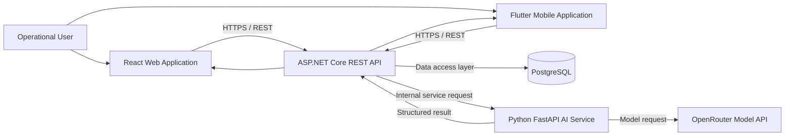
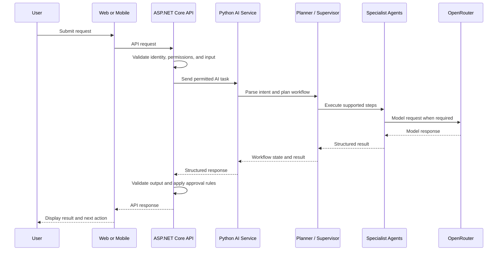

# ReliefNexus

**AI-Powered Disaster Management & Agentic AI Platform**

ReliefNexus is intended to connect disaster reporting, risk assessment, vulnerability and impact analysis, resource planning, early warning, volunteer coordination, and field response through a web application, mobile application, backend API, database, and AI service.

> **Accuracy note:** This README is based on the existing project documentation available for this conversation. Confirm paths, commands, environment variables, API routes, feature completeness, and deployment status against the current repository before relying on them. Source-code presence alone does not prove runtime correctness or production readiness.

## Table of Contents

- [Overview](#overview)
- [Goals](#goals)
- [Features](#features)
- [User Roles](#user-roles)
- [Workflow](#workflow)
- [Technology Stack](#technology-stack)
- [Architecture](#architecture)
- [Agentic AI](#agentic-ai)
- [Repository Structure](#repository-structure)
- [Database](#database)
- [API and Communication](#api-and-communication)
- [Prerequisites](#prerequisites)
- [Configuration](#configuration)
- [Local Setup](#local-setup)
- [Running the Applications](#running-the-applications)
- [Testing](#testing)
- [Security and Responsible AI](#security-and-responsible-ai)
- [Deployment](#deployment)
- [Troubleshooting](#troubleshooting)
- [Verification Checklist](#verification-checklist)
- [Contributing](#contributing)
- [License](#license)

## Overview

ReliefNexus is a disaster-management and emergency-response platform intended to provide connected workflows for reporting incidents, assessing risk, identifying vulnerability and impact, planning resources, coordinating warnings, assigning volunteers, and tracking field response.

The documented system includes a React web client, a Flutter mobile client, an ASP.NET Core REST API, PostgreSQL with Entity Framework Core, and a Python/FastAPI AI service integrated with OpenRouter. The backend is intended to remain the control boundary for authentication, authorisation, data persistence, validation, and consequential state changes.

### Goals

- Connect disaster reports, assessments, resources, and field operations.
- Support structured risk and vulnerability analysis.
- Help coordinators evaluate response options and resource requirements.
- Make AI-assisted planning and execution more traceable.
- Provide web and mobile access to supported workflows.
- Preserve human oversight over consequential emergency actions.

## Features

The existing project documentation identifies these feature areas. Verify the current UI, backend, persistence, permissions, and tests before treating any feature as complete.

| Feature | Purpose |
|---|---|
| Disaster reports | Submit and manage incident information. |
| Risk prediction | Produce structured risk information such as score, category, or confidence where supported. |
| Vulnerability and impact | Assess potential impacts, vulnerable populations, severity, and response needs. |
| Resource optimization | Recommend resources subject to actual inventory and eligibility rules. |
| Early warning and coordination | Prepare warning and coordination recommendations. |
| Volunteer assignment | Support volunteer matching and assignment workflows. |
| Field operations | Allow field volunteers to view assigned work and submit updates where implemented. |
| Assistance requests | Support relief requests where implemented. |
| User management | Manage accounts and role-based access. |
| Notifications and location sharing | Support operational communication where configured. |
| AI execution visibility | Show workflow state and agent results where implemented. |
| Web and mobile access | Provide React and Flutter interfaces. |

## User Roles

Existing documentation names these roles:

| Role | Intended responsibility |
|---|---|
| Affected User | Submit reports or assistance requests and access permitted information. |
| Relief Coordinator | Review incidents and coordinate response activities within assigned permissions. |
| Field Volunteer | View assigned work and submit field response updates within assigned permissions. |
| System Administrator | Manage system-level functions according to configured permissions. |

The authoritative permissions must be verified in backend policies, claims, role definitions, and client route guards. Hiding a UI control is not a substitute for server-side authorisation.

## Workflow

The documented high-level workflow is:

```text
Disaster Report
      |
      v
Risk Prediction
      |
      v
Vulnerability & Impact Assessment
      |
      v
Resource Optimization
      |
      v
Early Warning & Coordination
      |
      v
Volunteer Assignment
      |
      v
Field Response and Updates
      |
      v
Review and Resolution
```

Actual paths may vary according to incident type, data availability, permissions, resource eligibility, and approval status.

## Technology Stack

The following technologies are reported in existing project documentation. Verify versions and active configuration in the current checkout.

| Layer | Technology | Responsibility |
|---|---|---|
| Web | React, TypeScript, Vite | Browser interface |
| Mobile | Flutter, Dart | Mobile interface |
| Backend | ASP.NET Core / .NET 8 | API, business rules, authorisation, orchestration |
| Database | PostgreSQL | Persistent application data |
| ORM | Entity Framework Core | Backend data access and migrations |
| AI service | Python, FastAPI | AI request handling and agent workflows |
| LLM gateway | OpenRouter | Model API access |
| Reported model | `openai/gpt-oss-20b` | Verify against runtime configuration |
| Backend tests | xUnit | Verify test project and configuration |
| E2E tests | Playwright | Verify configuration and test files |
| Mobile tests | Flutter test | Flutter test suite |
| Reported web hosting | Vercel | Verify current deployment settings |
| Reported backend/AI/database hosting | Render | Verify current deployment settings |

## Architecture



This diagram reflects the documented intended architecture. Verify the actual service URLs, authentication path, and deployment networking in source and hosting configuration.

### Component responsibilities

- **Web frontend:** pages, dashboards, forms, navigation, and API-driven UI state.
- **Mobile application:** mobile screens and supported workflows using the configured backend API.
- **ASP.NET Core backend:** endpoints, business rules, permissions, validation, persistence, and controlled AI integration.
- **Python AI service:** AI request processing, planning, and agent execution where implemented.
- **PostgreSQL:** persistent data managed by the configured backend data layer.
- **OpenRouter:** external model API access for the AI service.

## Agentic AI

Existing documentation describes five specialist agents:

| Agent | Intended responsibility | Key validation concerns |
|---|---|---|
| Agent 01 — Risk Prediction | Structured risk score/category and confidence where supported. | Validate inputs and outputs; record provenance and uncertainty. |
| Agent 02 — Vulnerability & Impact | Vulnerability, impact, severity, affected population, and recommendations where supported. | Link to the correct assessment and validate required data. |
| Agent 03 — Resource Optimization | Resource recommendations based on needs and inventory. | Enforce actual inventory, eligibility, and quantity constraints. |
| Agent 04 — Early Warning & Coordination | Warning and coordination recommendations. | Apply appropriate approval before external actions. |
| Agent 05 — Volunteer Assignment | Volunteer matching and assignment support. | Validate availability, permissions, and assignment rules. |

### Intended orchestration sequence



Verify the exact call sequence and which agents use the model before treating this as an implementation trace.

### AI safety principles

- Validate model responses before using them in application logic.
- Map plans to supported backend operations; do not execute arbitrary model-generated instructions.
- Keep permission enforcement in the backend.
- Bound retries and replanning.
- Make failures, uncertainty, and approval status visible.
- Require appropriate human approval for consequential actions.
- Do not present AI-generated risk information as guaranteed truth or a replacement for authorised emergency decisions.

## Repository Structure

This is the high-level structure recorded in the existing project documentation. It is not guaranteed to be an exhaustive current tree; check the checkout and update paths before relying on them.

```text
ReliefNexus/
├── backend/
│   ├── ReliefNexus.API/
│   │   ├── AI/
│   │   ├── Controllers/
│   │   ├── Data/
│   │   ├── Interfaces/
│   │   ├── Migrations/
│   │   ├── Models/
│   │   ├── Services/
│   │   └── Program.cs
│   └── ReliefNexus.API.Tests/
├── frontend/
│   ├── src/
│   │   ├── app/
│   │   ├── components/
│   │   └── features/
│   ├── public/
│   ├── tests/
│   ├── package.json
│   └── vite.config.*
├── mobile/
│   ├── lib/
│   ├── android/
│   ├── ios/
│   ├── assets/
│   ├── test/
│   ├── pubspec.yaml
│   └── README.md
├── ai-service/
│   ├── app/
│   └── requirements.txt
├── .github/
│   └── workflows/
└── README.md
```

### Folder reference

| Path | Responsibility |
|---|---|
| `backend/ReliefNexus.API/Controllers/` | Backend HTTP endpoints, subject to current implementation. |
| `backend/ReliefNexus.API/Services/` | Application and business services. |
| `backend/ReliefNexus.API/Models/` | Backend data/domain models. |
| `backend/ReliefNexus.API/Data/` | Database context and persistence configuration. |
| `backend/ReliefNexus.API/Migrations/` | Entity Framework Core migrations. |
| `backend/ReliefNexus.API/AI/` | Backend AI integration/orchestration components if present. |
| `backend/ReliefNexus.API.Tests/` | Backend tests if present. |
| `frontend/src/` | React application source. |
| `frontend/src/features/` | Feature modules if present. |
| `frontend/src/components/` | Shared UI components if present. |
| `frontend/tests/` | Frontend tests if present. |
| `mobile/lib/` | Flutter source code. |
| `mobile/test/` | Flutter tests. |
| `mobile/android/`, `mobile/ios/` | Native platform configuration. |
| `ai-service/app/` | Python AI service code if matching the current layout. |
| `.github/workflows/` | GitHub Actions workflows if configured. |

For a fully exact folder reference, regenerate this tree from the current repository and include all meaningful first-party feature subdirectories.

## Database

Existing documentation identifies PostgreSQL and Entity Framework Core as the backend persistence stack. The migration directory is documented as:

```text
backend/ReliefNexus.API/Migrations/
```

An `InitialCreate` migration is also mentioned in the existing documentation; confirm the actual migration files and schema before applying changes.

Recommended practices:

- Evolve the schema through reviewed migrations.
- Keep database credentials outside source control.
- Validate input before persistence.
- Use constraints and transactions where required for consistency.
- Avoid destructive database resets where data must be retained.
- Keep AI recommendations separate from authorised state changes until validation and approval rules are satisfied.

Create an ER diagram from actual entities and migrations rather than inferring table names from feature names.

## API and Communication

The web and mobile clients are intended to call the ASP.NET Core API. The backend is documented as calling the Python AI service, which integrates with OpenRouter.

The existing documentation reports this frontend API base URL:

```text
https://reliefnexus.onrender.com/api
```

Verify the current URL and base path before using it.

Generate the endpoint catalogue from actual controller route attributes and FastAPI route declarations. For each endpoint, document the method, path, purpose, authentication requirement, request/response schema, validation behavior, error responses, and source file. Do not add guessed endpoints.

## Prerequisites

Install the tools required by the components you intend to run:

- Git.
- .NET 8 SDK for the backend described in project documentation.
- Node.js and npm for the React/Vite frontend.
- Python 3.x for the FastAPI service.
- Flutter SDK (includes Dart).
- PostgreSQL.
- Android Studio and Android SDK for Android emulator development, or a configured physical device.

Use actual project manifests to resolve version differences.

## Configuration

The names below are reported by existing documentation. Verify them against configuration code and deployment settings.

### Backend

```text
ConnectionStrings__DefaultConnection
Jwt__Key
Jwt__Issuer
Jwt__Audience
```

Also configure the AI-service base URL using the exact setting name defined by the backend.

### AI service

```dotenv
OPENROUTER_API_KEY=your_openrouter_api_key
OPENROUTER_MODEL=openai/gpt-oss-20b
```

Verify whether both variables are required and whether the model identifier matches current runtime configuration.

### Frontend

```dotenv
VITE_API_BASE_URL=https://reliefnexus.onrender.com/api
```

For local development, use the actual local backend URL and API prefix expected by the frontend client.

### Secrets policy

- Never commit API keys, database passwords, JWT signing keys, or tokens.
- Do not put server-side secrets in `VITE_*` variables because they are exposed to browser code.
- Use local environment files excluded from Git or the hosting provider's secret configuration.
- Rotate any credential that has been committed; deleting it from the latest revision is not enough.

## Local Setup

Commands below are starting points based on the documented folder layout. Confirm paths, entry points, and scripts in the current checkout before using them.

### 1. Clone the repository

```powershell
git clone https://github.com/ResQAI-Dev/ReliefNexus.git
cd ReliefNexus
```

### 2. Prepare PostgreSQL

1. Start PostgreSQL.
2. Create a development database.
3. Configure the backend connection string.
4. Confirm the database user has suitable development permissions.
5. Apply the project's Entity Framework Core migrations using the actual solution/project configuration.

Review migrations before applying them to any production database.

### 3. Start the AI service

From the actual AI-service directory, if it contains `requirements.txt` and `app/main.py`:

```powershell
py -m venv .venv
.\.venv\Scripts\Activate.ps1
py -m pip install -r requirements.txt
```

Configure required environment variables. If `app.main:app` is the real FastAPI entry point:

```powershell
py -m uvicorn app.main:app --reload --port 8000
```

Use the repository's actual entry point and dependency manager if different.

### 4. Start the backend

In a separate terminal:

```powershell
cd backend\ReliefNexus.API
dotnet restore
dotnet build
dotnet run
```

Set database, authentication, and AI-service configuration first. Use the URL printed by the running application. `/swagger` is available only if Swagger is enabled in that environment.

### 5. Start the frontend

In a separate terminal:

```powershell
cd frontend
npm install
npm run dev
```

Confirm the scripts in `frontend/package.json` and configure the API base URL.

### 6. Start the Flutter application

In a separate terminal:

```powershell
cd mobile
flutter pub get
flutter devices
flutter run
```

For Android emulator development, configure the API host address appropriate to the emulator. The emulator's `localhost` is not the host computer's `localhost`. For a physical device, ensure network routing, firewall, and HTTP/HTTPS settings permit access.

### Typical startup order

1. PostgreSQL.
2. AI service, if required by the tested workflow.
3. ASP.NET Core backend.
4. React frontend and/or Flutter app.

The actual dependency order depends on the feature being tested.

## Testing

Run commands supported by the current project configuration. Common checks for the documented stack are shown below.

### Backend

```powershell
dotnet restore
dotnet build
dotnet test
```

Run these from the solution directory or pass the actual solution/test project path. Existing documentation identifies xUnit; confirm the test project and framework.

### Frontend

```powershell
npm install
npm run build
```

Run tests using scripts in `package.json`. Playwright is mentioned in existing documentation; verify its configuration and test files.

### AI service

Use the test command and framework configured by the Python project. Do not assume a particular test framework without checking the files.

### Flutter

```powershell
flutter pub get
flutter analyze
flutter test
```

Review individual analyzer diagnostics and distinguish pre-existing problems from newly introduced ones. A successful build alone does not prove the entire workflow works.

### Important end-to-end checks

- Authentication and role-specific access.
- Report submission and retrieval.
- Risk prediction.
- Vulnerability and impact assessment.
- Resource eligibility and optimization.
- Approval-gated warnings or assignments.
- Field update submission and retrieval.
- Error handling when the database or AI provider is unavailable.

Record actual results; do not claim tests passed unless they were run.

## Security and Responsible AI

Disaster-management software can influence decisions affecting people, supplies, and emergency response.

### Security principles

- Enforce permissions in the backend.
- Validate client input.
- Keep credentials server-side.
- Use HTTPS in deployed environments.
- Avoid exposing sensitive personal or location data in logs.
- Use least-privilege database credentials.
- Return useful but non-sensitive errors.
- Record consequential state changes where audit capabilities exist.
- Protect administrative and approval workflows.

### Responsible AI principles

- AI output can be incomplete or incorrect.
- Validate model responses before using them in application logic.
- Do not execute arbitrary model-generated instructions.
- Enforce deterministic inventory and permission constraints.
- Require human approval where the workflow specifies it.
- Make failure and uncertainty visible.
- Do not claim predictive accuracy without an evaluation dataset and methodology.
- This README does not certify the system as secure or production-ready.

## Deployment

Existing project documentation reports Vercel for the web frontend and Render for backend, AI service, and database hosting. These are reported targets, not proof that deployments are currently healthy.

Before release:

1. Verify build and startup commands.
2. Configure production secrets in the hosting environment.
3. Set the correct frontend API URL.
4. Restrict database access to authorised services.
5. Limit AI-service access to intended network paths.
6. Review HTTPS and CORS.
7. Apply migrations through a controlled release process.
8. Review logs and health checks.
9. Test role permissions and approval gates.
10. Confirm backup, recovery, and rollback procedures.

Use actual hosting configuration and service settings for deployment-specific instructions.

## Troubleshooting

| Symptom | Possible cause | Diagnostic approach |
|---|---|---|
| Backend does not start | Missing SDK, invalid configuration, occupied port, or database failure | Check `dotnet --info`, startup logs, and connection settings. |
| Database connection fails | PostgreSQL stopped, invalid credentials, or incorrect database name | Verify the service and connection settings without sharing passwords. |
| AI request fails | Missing provider key, invalid model configuration, provider outage, or malformed request | Inspect AI-service logs and environment settings without exposing secrets. |
| Frontend cannot reach API | Incorrect API base URL, backend unavailable, or CORS | Inspect browser network errors and frontend API configuration. |
| Flutter cannot reach backend | Incorrect emulator/device address or firewall/network restrictions | Verify device connectivity and the configured API URL. |
| Flutter controller lifecycle assertion | A controller/resource is used after disposal or disposed at the wrong lifecycle boundary | Follow the first application-owned stack frame and fix ownership; do not remove disposal as a permanent workaround. |
| Flutter analyzer reports issues | Existing diagnostics, dependency changes, or code problems | Inspect exact diagnostics and prioritise errors relevant to the affected workflow. |
| AI workflow stops part-way | Missing prerequisite, agent failure, validation failure, or approval requirement | Inspect execution state and traces; do not bypass approval controls. |
| Migration fails | Schema mismatch or incompatible migration history | Review migration status and database state before attempting repair. Avoid destructive resets. |

## Verification Checklist

This README is a technical starting point, not proof of current runtime status. Verify and update these items before a release:

- [ ] Actual repository tree and application entry points.
- [ ] Web, backend, AI service, and mobile build commands.
- [ ] Database migrations and relationships.
- [ ] Environment variable names and defaults.
- [ ] API endpoints and request/response contracts.
- [ ] Backend enforcement of role permissions.
- [ ] Agent result propagation and shared-state consistency.
- [ ] Approval gates for consequential actions.
- [ ] Field update submission and controller lifecycle behavior.
- [ ] Automated tests for critical workflows.
- [ ] Deployment health, HTTPS, CORS, logging, and rollback.
- [ ] No secrets committed or exposed to clients.

Record the date, environment, and result when each check is performed. Do not mark an item complete without evidence.

## Contributing

1. Review the repository structure and conventions.
2. Create a focused branch for the change.
3. Keep changes scoped and avoid unrelated refactoring.
4. Preserve API contracts unless coordinated changes are required.
5. Add or update tests for behavior changes.
6. Run relevant formatters, analyzers, builds, and tests.
7. Review the diff for secrets, generated files, and unrelated edits.
8. Describe the change, verification performed, and known limitations in the pull request.

Changes to a workflow should be checked across all consumers: web, backend, AI service, mobile, and database.

## License

Check the repository root for a `LICENSE` file and follow its terms. If no license file exists, the project's license is **not confirmed**. Hosting a project on GitHub does not by itself make it open source.

---

## Documentation Maintenance

Keep this README aligned with the current source code. When a feature changes, update the relevant folder reference, architecture, API contracts, environment variables, setup commands, tests, and implementation status.

**Source of truth:** current source code, project manifests, migrations, configuration templates, automated tests, and verified deployment settings.
